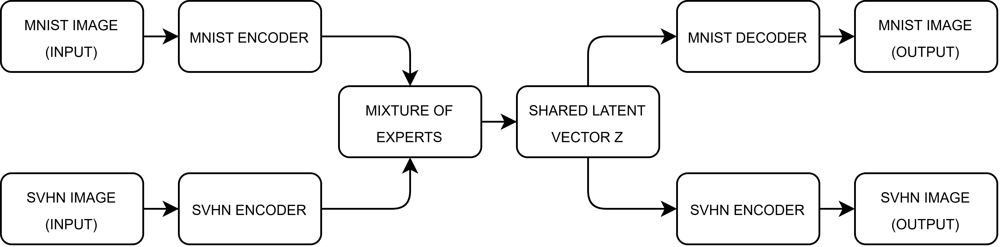

# Multi-View VAE: MNIST & SVHN

This repository contains the implementation of a Multi-View Variational Autoencoder (Joint VAE) designed to learn a shared latent representation from two distinct image domains: the grayscale MNIST dataset and the RGB SVHN dataset. 

## Project Overview
The goal of this project is to explore multimodal generative modeling. The model pairs images from both datasets based on their corresponding class labels and maps them into a unified latent space using a **Mixture of Experts** (MoE) approach. 

## Architecture

## Key Features & Capabilities
* **Custom Data Pipeline:** Pairs MNIST and SVHN images sharing the same label to train the joint distribution.
* **Multi-View VAE Architecture:** Utilizes domain-specific encoders and decoders linked by a shared latent space.
* **Image Reconstruction:** Accurately reconstructs original inputs from both the MNIST and SVHN domains.
* **Cross-Domain Generation:** Translates representations between modalities (e.g., generating an SVHN-style RGB image from a grayscale MNIST digit, and vice versa).
* **Latent Space Generation:** Samples completely new, unconditioned images directly from the prior distribution.
* **t-SNE Visualization:** Includes 2D projections of the shared latent space to analyze the clustering of multimodal features.